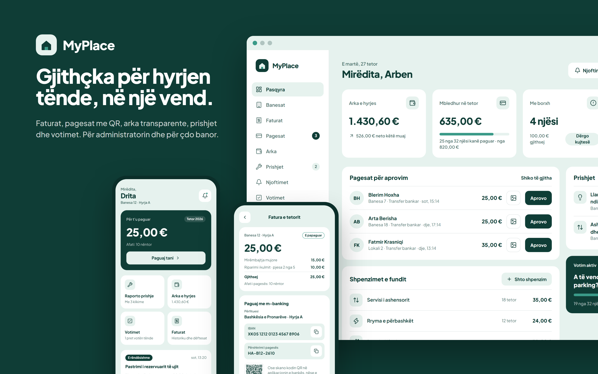
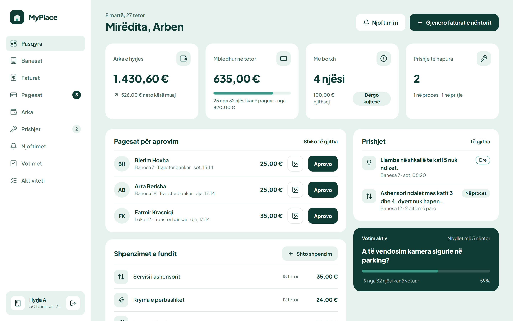
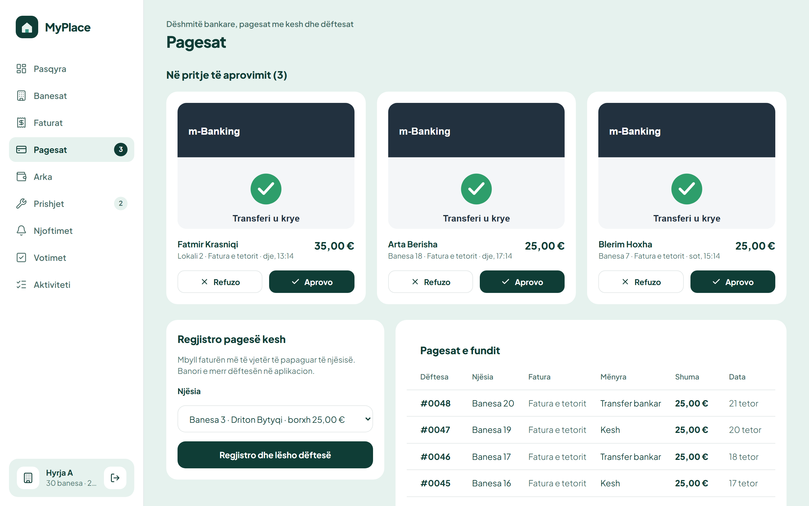
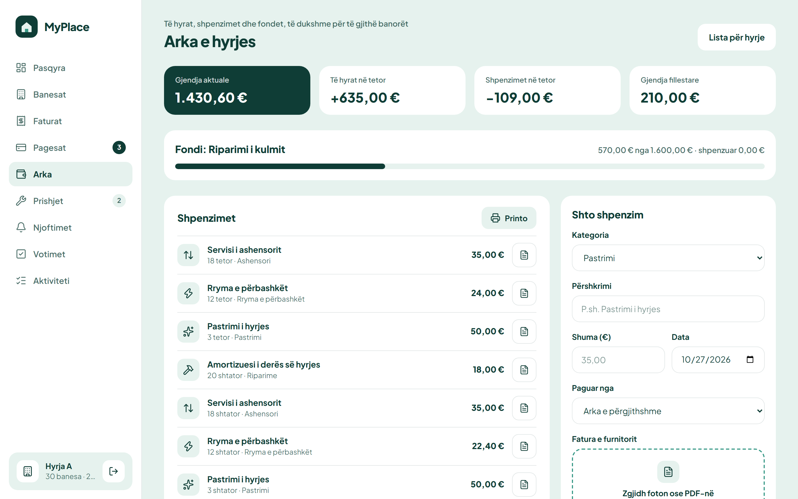
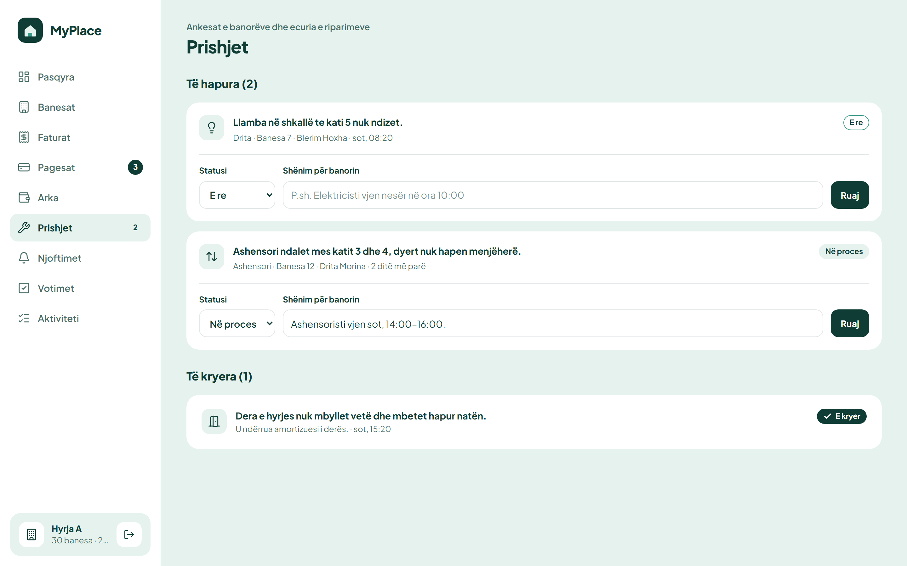
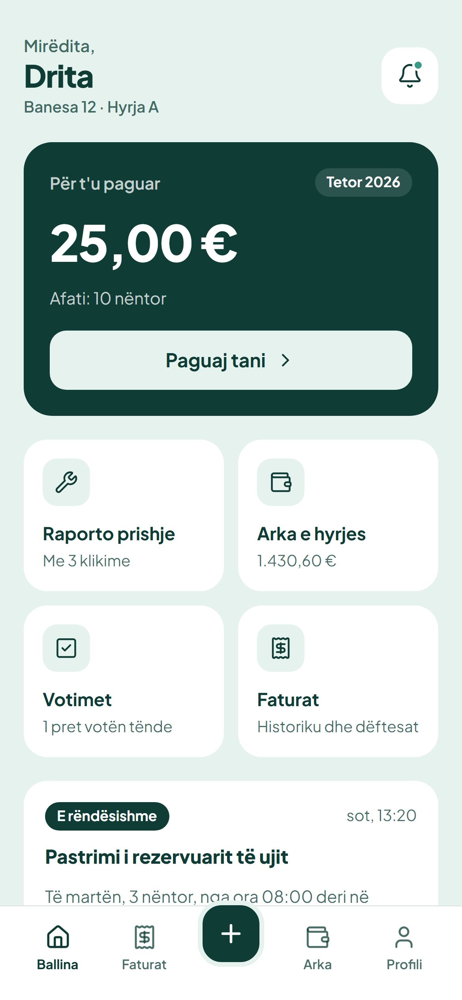
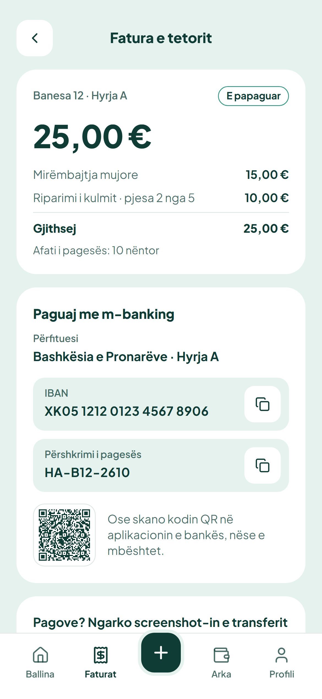
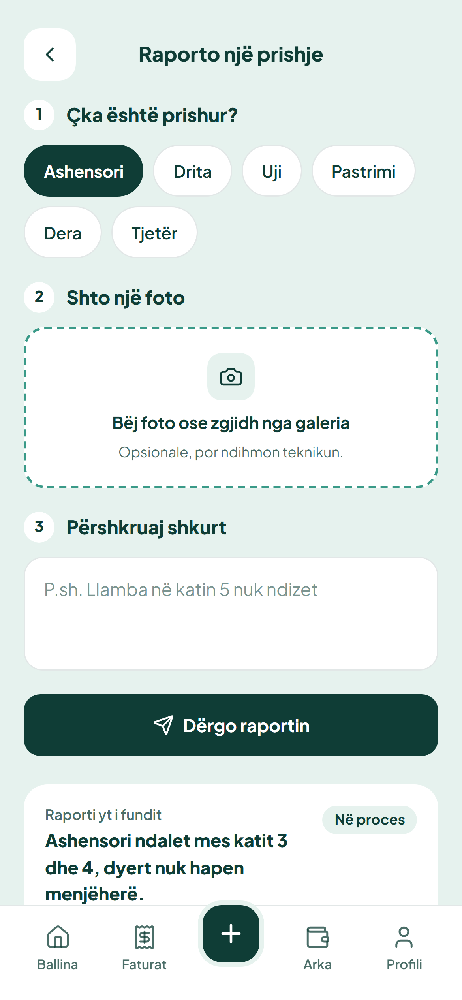
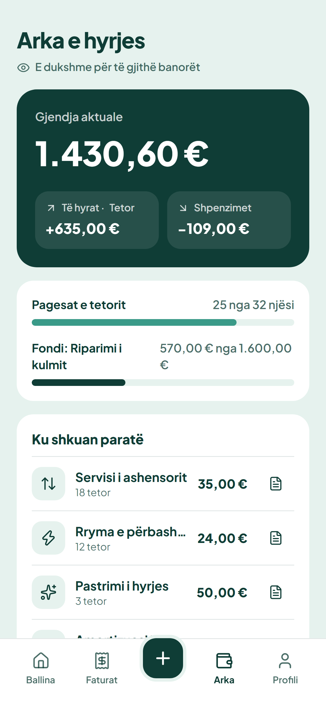
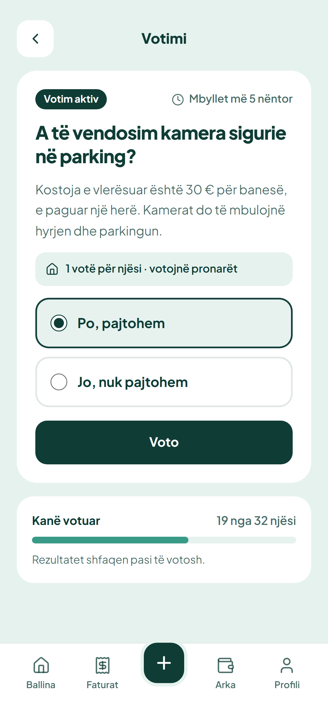

# MyPlace

Menaxhimi i hyrjes së banesave: faturat, pagesat, arka transparente, prishjet, njoftimet dhe votimet. Të gjitha në një vend.



Projekti ka dy pamje:

- **Paneli i administratorit** (`/admin`), për kryetarin e hyrjes ose kompaninë e menaxhimit, i ndërtuar për desktop.
- **Aplikacioni i banorit** (`/banori`), i ndërtuar për telefon, i thjeshtë edhe për banorët e moshuar.

> Projekt demonstrues. Të gjitha emrat, numrat dhe IBAN-i janë fiktivë.

## Çka bën

**Administratori**

- Pasqyra: gjendja e arkës, sa është mbledhur këtë muaj, borxhet, pagesat në pritje dhe prishjet.
- Gjeneron faturat mujore me një klik. Krijon fatura të jashtëzakonshme (p.sh. për kulmin) dhe i lidh me një fond.
- Aprovon ose refuzon dëshmitë bankare. Regjistron pagesat me kesh. Çdo pagesë merr dëftesë me numër rendor.
- Shton shpenzimet bashkë me foton e faturës së furnitorit.
- Ndjek prishjet sipas statusit: E re → Parë → Në proces → E kryer.
- Publikon njoftime. Te njoftimet e rëndësishme sheh kush ka klikuar «E lexova».
- Hap votime: një votë për njësi, me afat, dhe opsionin që të votojnë vetëm pronarët.
- Printon fletën për hyrje. Fleta nuk ka emra, vetëm numrat e njësive, për të ruajtur privatësinë.
- Ka regjistrin e aktivitetit: çdo veprim me para ose me status lë gjurmë.

**Banori**

- Sheh sa ka për të paguar, kopjon IBAN-in dhe përshkrimin e pagesës, ose skanon kodin QR.
- Ngarkon screenshot-in e transferit dhe pret aprovimin. Pastaj merr dëftesën.
- Raporton një prishje me tre hapa (çka, foto, përshkrim) dhe ndjek statusin e saj.
- Sheh arkën e hyrjes: ku shkuan paratë, me faturat e furnitorëve.
- Voton dhe lexon njoftimet.

## Pamje

| Paneli i administratorit | Pagesat për aprovim |
| --- | --- |
|  |  |
|  |  |

| Ballina | Fatura | Raporto | Arka | Votimi |
| --- | --- | --- | --- | --- |
|  |  |  |  |  |

## Teknologjia

- [Next.js 16](https://nextjs.org) (App Router, Server Actions, Cache Components), React 19, TypeScript
- Tailwind CSS 4: një ngjyrë në tre tone (`deep`, `mid`, `soft`) te `src/app/globals.css`
- Prisma 7 me SQLite (`@prisma/adapter-better-sqlite3`)
- Sesione me cookie `httpOnly` dhe fjalëkalime me `scrypt`, pa librari të jashtme për autentikim

## Si ta nisësh

```bash
cp .env.example .env
npm install
npx prisma migrate deploy
npm run db:seed
npm run dev
```

Hap [http://localhost:3000](http://localhost:3000).

### Llogaritë demo

Kur `DEMO_MODE="1"`, faqja e hyrjes ka butonat **Si administrator** dhe **Si banor**. Mund të hysh edhe me email:

| Roli | Email-i |
| --- | --- |
| Administratori | `admin@myplace.test` |
| Banore, Banesa 12 | `drita@myplace.test` |
| Banorë të tjerë | `blerim@`, `arta@`, `fatmir@myplace.test` |

Fjalëkalimi i përbashkët është `myplace-demo`.

`npm run db:seed` i fshin dhe i krijon nga e para të dhënat demo. Datat llogariten nga dita e sotme, kështu demo duket gjithmonë aktuale.

## Testet

Testet end-to-end me [Playwright](https://playwright.dev) përdorin databazën e tyre (`prisma/e2e.db`) dhe një build prodhimi në portin 3100:

```bash
npx playwright install chromium
npm run test:e2e
```

Janë 29 teste. Ato mbulojnë hyrjen dhe qasjen sipas rolit, aprovimin dhe refuzimin e pagesave, pagesat me kesh dhe dëftesat, gjenerimin e faturave, shpenzimet, prishjet, njoftimet, votimet, ngarkimin e skedarëve dhe kontrollin e qasjes te dëshmitë e pagesave.

`npm run screenshots` i rikrijon pamjet te `docs/screenshots/`.

## Struktura

```
prisma/schema.prisma     modeli i të dhënave (shumat në centë)
prisma/seed.ts           hyrja demo me 32 njësi
src/lib/                 auth, financat, formatimi, skedarët, regjistri i aktivitetit
src/app/hyr/             hyrja në llogari
src/app/admin/           paneli i administratorit dhe veprimet e tij
src/app/banori/          aplikacioni i banorit dhe veprimet e tij
src/app/api/skedaret/    dëshmitë dhe faturat, me kontroll qasjeje
storage/uploads/         skedarët e ngarkuar (jashtë /public)
```

## Hapat e ardhshëm

- Importi i banorëve dhe i borxheve të vjetra nga Excel
- Importi i ekstraktit bankar dhe lidhja automatike e pagesave sipas përshkrimit
- Njoftime në Viber/WhatsApp
- Disa hyrje për një kompani menaxhimi
- PWA: instalimi në telefon dhe njoftimet push
